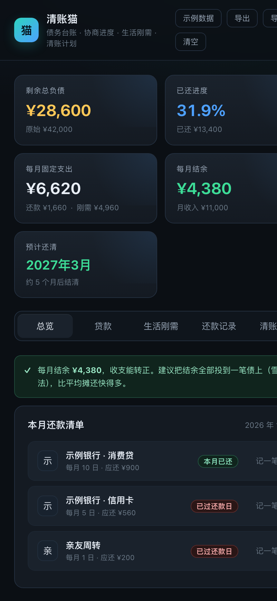
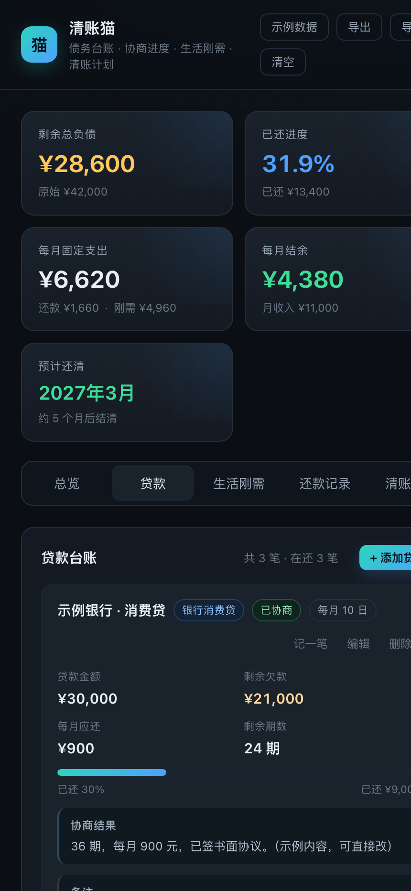
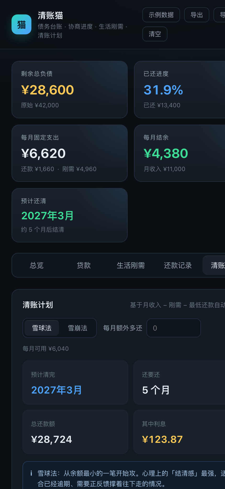

# 清账猫 · 债务管理与还款计划

> 一笔一笔还清，心里有数。一个**完全离线、不联网、不收集任何数据**的债务管理工具。

清账猫帮你把「欠了谁、多少钱、谈成什么、每月该还多少、活下去要花多少」摆在一张表上，
再用雪球法 / 雪崩法算出**到底还要还多久**。数据只存在你自己的设备里，不上传、不注册、不登录。

## 截图

| 概览 | 债务台账 | 清账计划 |
|---|---|---|
|  |  |  |

## 功能

- **债务台账**：平台名称、类型（信用卡 / 消费贷 / 网贷 / 亲友借款）、本金、剩余欠款、年化利率、每月应还、还款日
- **协商结果留档**：把和客服谈定的条件原样记下（例：3 年期、每月 600 元、不支持二次协商），日后有争议可查
- **生活刚需**：房租、水电、物业、猫生活费、人生活费五个固定分类，可加「其他」
- **每月缺口预警**：月收入 − 刚需 − 月供 的结余 / 缺口一眼看清，并给出「先谈哪一笔」的建议
- **雪球法 / 雪崩法模拟**：按月推演每笔债的结清时间线、总还款额、总利息，可填「每月额外多还」看提前多久
- **本月还款清单**：按还款日排序，标出已还 / 待还 / 已过还款日
- **记一笔打卡**：每次还款自动从剩余欠款扣减，还清自动标记结清
- **导入 / 导出 JSON**、打印排版、手机与桌面自适应

## 安装

### Android

到 [Releases](../../releases) 下载最新的 `qingzhangmao-x.y.z.apk`，点击安装即可（首次安装需允许「安装未知来源应用」）。

系统要求：Android 6.0（API 23）及以上。

### macOS

到 [Releases](../../releases) 下载 `qingzhangmao-x.y.z-macos.zip`（Intel 与 Apple 芯片通用），解压后把 `清账猫.app` 拖进「应用程序」。
首次打开如提示「无法验证开发者」，右键点图标 → 打开，或到「系统设置 → 隐私与安全性」里放行。

系统要求：macOS 12 及以上（Intel / Apple Silicon 均可自行编译）。

### 网页版（不想装 App）

直接用浏览器打开 [`web/index.html`](web/index.html)。数据存在浏览器 localStorage 里，
换浏览器或清理浏览器数据会丢，重要数据请用「导出」备份。

## 数据存在哪里

| 平台 | 位置 | 说明 |
|---|---|---|
| Android | App 私有目录 `data/records.json` | 每次改动即时写盘；`data/backups/` 保留最近 30 份每日快照 |
| macOS | `~/Library/Application Support/清账猫/records.json` | 同上，菜单「数据」可一键打开目录 |
| 网页 | 浏览器 localStorage | 清浏览器数据即丢 |

- 卸载 App 会连同数据一起删除，**卸载前请先导出**。
- 升级版本、覆盖安装都不会影响已有记录。
- 想多设备备份：用「导出」存一份 JSON，换设备后「导入」即可。

## 隐私

不联网、无第三方 SDK、无广告、无统计埋点，不申请任何敏感权限。
全部代码开源，可自行审计。详见 [隐私政策](docs/privacy.md)。

## 从源码构建

需要 JDK 17、Android SDK（compileSdk 34）和 Xcode 命令行工具。

```bash
# Android：产出 android/app/build/outputs/apk/debug/app-debug.apk
cd android && ./gradlew assembleDebug

# macOS：产出 macos/清账猫.app，加 --install 同时装到桌面
cd macos && ./build.sh --install
```

界面就是单个文件 [`web/index.html`](web/index.html)，改完重新构建即可，两个平台共用同一套 UI。

## 已知取舍

- 模拟按「每月固定可用额度」推算，不建模浮动利率、罚息、提前还款违约金
- 不支持多币种
- 不自动同步（这是特性，不是缺陷）

## 许可

[MIT](LICENSE)
